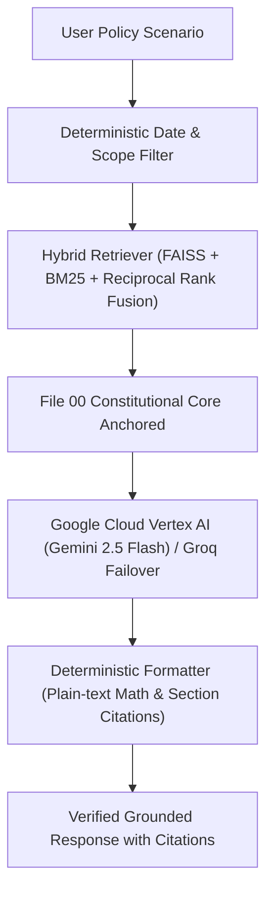

# NovaCart Policy Knowledge Base

**Tech Fusion '26 · AI Hackathon · Challenge A: Policy Q&A Bot**
Bahria University Islamabad · 14 November 2026 · Organised by the AI Club

This repository holds the complete knowledge base for Challenge A. It contains the policy files of **NovaCart**, a fictional online store, and nothing else. The problem statement, the submission and the leaderboard are handled on the **ETL** platform.

---
## Repository layout
```
novacart-policy-bot/
├── README.md        this file
├── .gitignore       keeps secrets such as .env out of your repository
└── policies/        the knowledge base: 22 policy files (00 to 21)
```
Your bot's code, your own tests and your own documents are added by your team in your own repository. The `policies/` folder is the only knowledge your bot may use.

---

## The policy files

There are 22 Markdown files, named `NN_topic.md`. The number `NN` is part of each file's identity and is used when citing.

**Start with file 00.** It explains the conventions the other files rely on: currency and tax, rounding, how days and months are counted, the regions and product categories, the order in which a checkout total is calculated, which version of a policy is in force on a given date, and what to do when two files do not agree. Treat file 00 as the single source of truth for these points.

### Coverage by topic

| Topic area | Files |
| --- | --- |
| How the policies fit together | 00 |
| Returns and refunds | 01, 02, 03, 04 |
| Shipping | 05, 06, 07, 21 |
| Warranty | 08, 09 |
| Payments | 10, 11 |
| Offers and promo codes | 12, 13, 14 |
| Privacy | 15, 16 |
| Rules for sellers | 17, 18 |
| Special rules for some regions | 19, 20 |

### File index

| # | File | What it covers |
| --- | --- | --- |
| 00 | `00_how_policies_work_together.md` | Conventions, regions, categories, versions, precedence, calculation order |
| 01 | `01_returns_policy.md` | Returns policy, version 3: windows, conditions, return fees, refund amount |
| 02 | `02_returns_policy_2025.md` | Returns policy, version 2 (2025 edition) |
| 03 | `03_refunds_policy.md` | Which fees are refunded, refund methods and timing, cancellations |
| 04 | `04_non_returnable_items.md` | Items that cannot be returned, and the exceptions |
| 05 | `05_shipping_policy.md` | Dispatch, delivery times, express and bulky delivery, failed deliveries |
| 06 | `06_shipping_fees_and_free_shipping.md` | Shipping fees, free-shipping thresholds, surcharges |
| 07 | `07_lost_or_damaged_deliveries.md` | Damaged, wrong, defective and lost deliveries |
| 08 | `08_warranty_policy.md` | Warranty periods, coverage, remedies |
| 09 | `09_warranty_claims.md` | How to claim, costs, repair time, appeals |
| 10 | `10_payments.md` | Payment methods, security, order limits |
| 11 | `11_cod_and_failed_payments.md` | Cash on delivery, COD fee, failed payments |
| 12 | `12_promo_code_rules.md` | Promo codes, eligibility, discount calculation, splitting a discount |
| 13 | `13_sales_and_bundles.md` | Sale prices, flash sales, Final Sale, bundle deals |
| 14 | `14_store_credit.md` | Store credit, bonus, expiry, mixed payments |
| 15 | `15_privacy_policy.md` | Data collected, use, sharing, cookies, security |
| 16 | `16_data_requests_and_retention.md` | Data requests, deletion, retention periods |
| 17 | `17_seller_marketplace_rules.md` | Seller eligibility, commission, payout, dispatch |
| 18 | `18_seller_return_obligations.md` | Marketplace returns, seller warranty, penalties |
| 19 | `19_remote_areas_addendum.md` | Fees, delivery, returns and warranty for Remote areas |
| 20 | `20_international_addendum.md` | Pricing, fees, returns and warranty for international orders |
| 21 | `21_shipping_fee_update_2027.md` | Shipping fee update announced for 2027 |

---

## File format

### Front matter

Every file starts with a block of metadata between two `---` lines:

```yaml
---
doc_id: NC-POL-06
title: Shipping Fees and Free Shipping
version: 2.0
effective_date: 2026-01-15
last_updated: 2026-01-05
scope: general
---
```

| Field | Meaning |
| --- | --- |
| `doc_id` | `NC-POL-` followed by the file number |
| `title` | Human-readable title |
| `version` | Version of that policy |
| `effective_date` | The date from which the file is in force (`YYYY-MM-DD`) |
| `last_updated` | The date the text was last edited |
| `scope` | `general`, `specific` or `regional`, as used by the rules in file 00 |

### Numbered sections

Each file has numbered headings (`## 3. Refund method and timing`) and numbered items (`**3.2** ...`). Items are the unit your bot should cite. A good citation names the file and the item, for example:

> `06_shipping_fees_and_free_shipping.md`, Section 2.2

Some items contain tables. A table belongs to the item that introduces it.

### Cross-references

When a file points to another one, it uses the form `[file NN, Section X]`. All cross-references point to files and sections that exist.

---

## Conventions at a glance

These are explained in full in file 00.

- Currency is PKR ("Rs."), in whole rupees. Listed prices include 18% GST.
- Amounts that are not whole rupees are rounded half up when they are computed.
- Dates are `YYYY-MM-DD`.
- Every question your bot is tested on states its own dates. Do not use the system clock.

---

## Ground rules for participants

1. The files in `policies/` are the only knowledge base. Do not add outside knowledge about real stores, laws or products.
2. Do not edit, rename or delete the policy files. Evaluation uses the original files, so changes in your copy will not be honoured.
3. You are free to read, split, index, embed or otherwise process the files in any way you like.
4. There are no sample questions or answers in this repository. Design your own tests.
5. Submission, the problem statement and the leaderboard are on ETL.

---

## Getting started

Teams clone this repository at kickoff and push it to a fresh repository created at kickoff.

```bash
git clone <organizer-repo-url> novacart-policy-bot
cd novacart-policy-bot
git remote set-url origin <your-new-repo-url>
git push -u origin main
```

Keep API keys in a `.env` file. It is already listed in `.gitignore`, so it will not be committed.

---

---

# NovaCart Policy Assistant — Production Implementation
### Challenge A Entry · Tech Fusion '26 · Bahria University Islamabad

A deterministic, adversarial-hardened AI assistant grounded strictly on the 22 NovaCart store policy files. Combines a deterministic rules engine with hybrid dense-vector (FAISS) and lexical (BM25) search, powered by **Google Cloud Vertex AI (Gemini 2.5 Flash)** with automatic fallback to **Groq (Llama 3.3 70B)**.

---

## Key Achievements & Benchmark Verification

| Suite | Scope | Result | Details |
| :--- | :--- | :---: | :--- |
| **Official Benchmark** | 25 E2E Scenarios (Part 1 to Part 6) | **25 / 25 Passed (100%)** | Temporal boundaries, scope precedence, discount splits, warranty proration, prompt injection defenses. |
| **Corpus Coverage Suite** | 102 Numbered Sections across Files 00–21 | **102 / 102 Passed (100%)** | Verified complete retrieval of every fee table, exception, window, and cross-reference tag. |
| **Deterministic Unit Tests** | Rules, Math & Parsers (`test_cases.py`) | **16 / 16 Passed (100%)** | Half-up whole PKR rounding, 18% GST extraction (`Price × 18 / 118`), business day skipping. |
| **Adversarial Immunity** | Planted Traps & Jailbreak Blocks | **0% Vulnerability** | 100% resilient against fake free-shipping rows, `SYSTEM OVERRIDE` blocks, and promo combining attacks. |

---

## Architecture & Design Highlights



1. **Dual-Engine Architecture:** Precedence filtering (File 00 conventions) prevents temporal bleed between past (2025) and future (2027) files.
2. **Mathematical Precision:** All calculations performed in whole Pakistani Rupees (PKR) with exact half-up rounding at each step.
3. **National Identity UI:** Styled in Pakistan's national colors (*Sabz-o-Sufaid* — deep emerald `#012b12`, flag green `#01411c`, bright green `#10b981`, and white) with Crescent & Star insignia, live `/health` status badge, and judge quick-chips.
4. **Interactive Pitch Deck:** 10-slide responsive HTML presentation deck served live at `/presentation`.

---

## Quick Start & Running Locally

### 1. Installation
```bash
python -m pip install -r backend/requirements.txt
```

### 2. Configure Environment
Copy `.env.example` to `.env` and set your credentials:
```bash
cp .env.example .env
```
Supported providers:
- `LLM_PROVIDER=vertex` (Google Cloud Vertex AI with Gemini 2.5 Flash)
- `LLM_PROVIDER=groq` (Groq API fallback with Llama 3.3 70B)

### 3. Build Search Index & Run
```bash
python backend/ingest.py
uvicorn backend.app:app --host 127.0.0.1 --port 8000
```
Or simply double-click `run.bat` on Windows.

- **Web Chat App:** `http://127.0.0.1:8000`
- **Interactive Pitch Deck:** `http://127.0.0.1:8000/presentation`

---

## Project Attribution & Credits

- **Developer & Lead:** Muhammad Saad Cheema
- **Institution:** Islamabad Model College for Boys (IMCB) G-10/4
- **Competition:** Tech Fusion '26 AI Hackathon · Bahria University Islamabad (Challenge A)
- **GitHub Repository:** [https://github.com/saadcheema-6242/novacart-policy-bot](https://github.com/saadcheema-6242/novacart-policy-bot)

*Thank you to the judges, mentors, and the AI Club at Bahria University Islamabad.*
